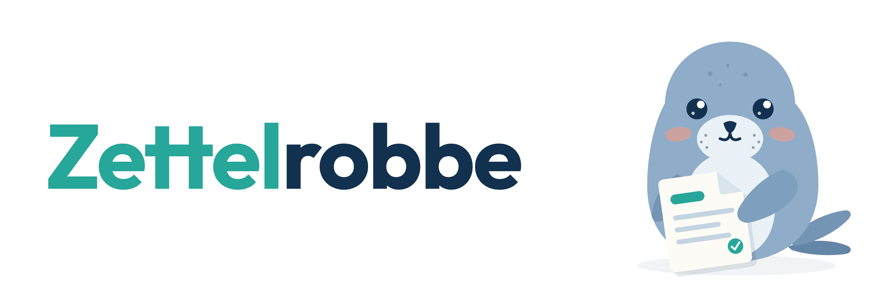

<div align="center">

<picture>
  <source media="(prefers-color-scheme: dark)" srcset="./logo-dark.png">
  
</picture>

<h1>Zettelrobbe</h1>

AI tagging for [Paperless-ngx](https://github.com/paperless-ngx/paperless-ngx): titles, tags, correspondents and document types, assigned by a model you choose.

[](https://github.com/admonstrator/zettelrobbe/releases/latest) [](https://hub.docker.com/r/admonstrator/zettelrobbe) [](https://github.com/admonstrator/zettelrobbe/actions/workflows/ci.yml) [](https://zettelrob.be/)

[Install](#install) · [First run](#first-run) · [The pages](#the-pages) · [Good to know](#good-to-know) · [When something does not work](#when-something-does-not-work) · [Full documentation](https://zettelrob.be/)

</div>

---

## What it does

Zettelrobbe sits next to your Paperless-ngx instance. On a schedule (every 30 minutes by default) it looks for documents it has not seen yet and, for each one:

1. fetches the document text from Paperless-ngx,
2. sends it to your AI provider together with your prompt,
3. writes the answer back: title, tags, correspondent, document type, language and the custom fields you configured,
4. keeps a snapshot of what the document looked like before, so you can restore it.

A document with too little text takes a detour through the OCR queue first, if you switched that on.

It runs as one Docker container (Node.js, SQLite, about 512 MB RAM) and talks to Paperless-ngx only through its API. More detail: [How it works](https://zettelrob.be/how-it-works/).

**AI providers:** OpenAI, Anthropic, Azure OpenAI, Ollama, and any OpenAI-compatible endpoint (LM Studio, OpenRouter, DeepSeek, Perplexity, Gemini through its compatibility layer, LiteLLM).

---

## Install

You need:

- Docker with Docker Compose
- a running Paperless-ngx and an API token for it
- an AI provider account, or a local model server such as Ollama

```yaml
services:
  zettelrobbe:
    image: admonstrator/zettelrobbe:latest
    container_name: zettelrobbe
    restart: unless-stopped
    ports:
      - '3000:3000'
    volumes:
      - data:/app/data
    environment:
      # Opens the setup wizard to browsers on other machines.
      # Remove this line once setup is finished.
      - ALLOW_REMOTE_SETUP=yes
      # Only when you open Zettelrobbe over plain http:// (no TLS proxy):
      # - COOKIE_SECURE_MODE=never

volumes:
  data:
```

```bash
docker compose up -d
```

Then open `http://<your-host>:3000`.

Four things that go wrong here more often than anything else:

| What you see                                | Why                                                                                                                                   | Fix                                                                                                                                                                        |
| ------------------------------------------- | ------------------------------------------------------------------------------------------------------------------------------------- | -------------------------------------------------------------------------------------------------------------------------------------------------------------------------- |
| `403 – Remote Setup Access Denied`          | Until setup is finished, the wizard only answers requests from localhost. A browser talking to a container never counts as localhost. | Set `ALLOW_REMOTE_SETUP=yes`, as in the file above.                                                                                                                        |
| Login fails with `Invalid CSRF token`       | You are on plain HTTP and the login cookies are not accepted.                                                                         | Set `COOKIE_SECURE_MODE=never` and restart. Behind a TLS reverse proxy use `COOKIE_SECURE_MODE=auto` and `TRUST_PROXY=1` instead.                                          |
| The Paperless-ngx connection test fails     | `localhost` inside the container is the container itself.                                                                             | Use the address the container can reach. In the same Docker network that is the service name, for example `http://paperless-ngx:8000`. Enter the base URL, without `/api`. |
| The app does not come back after the wizard | The wizard ends by restarting the app and relies on Docker to start it again.                                                         | Keep `restart: unless-stopped`, or start the container once by hand.                                                                                                       |

All environment variables: [Configuration reference](https://zettelrob.be/getting-started/configuration/#docker-environment-variables).

---

## First run

Have these ready before you open the wizard:

- the Paperless-ngx base URL, your Paperless username and an API token
- the URL, model name and (if needed) API key of your AI provider

The wizard has seven steps:

1. **Admin account.** A local account for Zettelrobbe, unrelated to your Paperless-ngx users. Password: 8 characters or more.
2. **Two-factor authentication (optional).** TOTP with any authenticator app. Can be switched on later in the settings.
3. **Paperless-ngx.** URL, username, token, then **Test Paperless connection**. The test also checks that the token has the permissions Zettelrobbe needs.
4. **Document scope.** All documents, or only those carrying certain tags. Also the ignore tag, the "processed" marker tag and the scan interval.
5. **AI provider.** **Quickstart** probes a local model server and picks models for you. **Manual configuration** takes a provider preset, URL, model and key; **Fetch models** reads the model list from your endpoint.
6. **OCR (optional).** Off unless you enable it. See [OCR](#ocr).
7. **Review.** Shows the configuration it is about to write, then **Save and restart container**.

After that `/setup` is closed for good and you sign in at the login page. Screenshots of every step: [First Setup](https://zettelrob.be/getting-started/first-setup/).

> [!TIP]
> For the first run, choose "only documents with these tags" in step 4 and put that tag on five or ten documents in Paperless-ngx. Look at the results, adjust the prompt, and widen the scope once you like what you get.

### Your first document

1. Add a document to Paperless-ngx as usual.
2. On the dashboard, click **Scan now** in the **Task runner** widget. Otherwise the next scheduled scan picks it up.
3. Open **History**. The document is at the top with its new title and correspondent.
4. Click **Details** to see the assigned tags, the token usage and the state before processing.
5. Not what you wanted? **Rescan** runs it again with your current settings. **Restore Original** puts the document back exactly as it was.

The same walkthrough with screenshots: [Your First Document](https://zettelrob.be/guides/first-document/).

---

## The pages

| Page      | Path         | What you do there                                                                                                                                                                                          |
| --------- | ------------ | ---------------------------------------------------------------------------------------------------------------------------------------------------------------------------------------------------------- |
| Dashboard | `/dashboard` | See how much is processed and what is waiting. Start or stop a scan by hand. A banner appears here when Paperless-ngx is unreachable.                                                                      |
| Manual    | `/manual`    | Analyse one document now. Nothing is written to Paperless-ngx until you press **Save Tags**, which also makes this the place to try out a changed prompt.                                                  |
| History   | `/history`   | Every processed document with what was assigned. Rescan, restore the original, or do either for several rows at once.                                                                                      |
| OCR queue | `/ocr`       | Documents waiting for OCR, with the reason. Process them, read the extracted text, or add any document by hand.                                                                                            |
| Tidy up   | `/tidy-up`   | Suggestions for merging names that mean the same (`invoice`, `Invoices`), splitting compound tags and deleting unused ones. Nothing changes until you accept a suggestion, and every change can be undone. |
| Failed    | `/failed`    | Documents that failed three times, with the reason. Reset them or move them to Ignored.                                                                                                                    |
| Ignored   | `/ignored`   | Documents every scan skips until you remove them from the list.                                                                                                                                            |
| Settings  | `/settings`  | Everything the wizard set, and the rest.                                                                                                                                                                   |

Documentation per feature: [Automatic tagging](https://zettelrob.be/features/auto-tagging/) · [Manual tagging](https://zettelrob.be/features/manual-tagging/) · [History & Restore](https://zettelrob.be/features/history/) · [OCR queue](https://zettelrob.be/features/ocr-queue/) · [Tidy up](https://zettelrob.be/features/tidy-up/) · [Settings tour](https://zettelrob.be/guides/settings-tour/)

---

## Good to know

Things that are easy to miss and cost time when you do.

### Where your documents go

- Document text is sent to the AI provider and the OCR provider you configured, and nowhere else. With a hosted provider, that provider's privacy and retention terms apply to your documents.
- With Ollama or another local server for both AI and OCR, no document text leaves your network.
- Once a day Zettelrobbe asks GitHub whether a newer release exists. `UPDATE_CHECK_ENABLED=no` switches that off.

### Tagging

- **"Restrict to existing tags" does not show the model your tags.** The toggle only discards names that do not exist yet. To let the model pick from your list, put `%RESTRICTED_TAGS%` into your prompt (also `%RESTRICTED_CORRESPONDENTS%` and `%RESTRICTED_DOCUMENT_TYPES%`). With the toggle alone, documents simply come back with fewer tags than you expected. Details and a worked example: [The system prompt](https://zettelrob.be/getting-started/configuration/#the-system-prompt).
- **Those lists are sent with every document** and count against `TOKEN_LIMIT`. With a thousand tags, less of the document itself fits into the request.
- **You do not ask for JSON in your prompt.** Zettelrobbe appends the output format itself.
- **Near-duplicates are caught for tags and correspondents:** if the model proposes `Invoices` and `invoice` exists, the existing one is used. This does not cover document types and does not catch typos.
- **A document is given up on after three failed attempts** and parked on the Failed page, so it cannot block the others.

### OCR

- OCR is off by default. Without it, a document with fewer than 10 characters of text (`MIN_CONTENT_LENGTH`) is skipped.
- Documents get into the queue on their own, but they do not get out of it on their own: someone has to press **Process All Pending**, unless you set `OCR_AUTO_PROCESS_ENABLED=yes`.
- Only two things queue a document automatically: too little text, or an AI analysis that failed in a way OCR can fix (the model reported insufficient content, or its answer was unreadable). A long but garbled text passes both checks. Add such documents by hand on `/ocr`.
- Mistral OCR is a paid API. A local vision model costs one request per page, up to `OCR_PDF_RENDER_MAX_PAGES` (default 10) pages per PDF.

### Settings

- A variable set in your compose file always wins over the Settings page. The field is then greyed out and says _Set by the environment_.
- Everything saved in the UI lives in `data/runtime-overrides.json` inside the volume.
- **Settings → Export** gives you the running configuration as a `.env` file. It contains your tokens and keys in clear text.
- A few settings need a restart (port, cookie and proxy flags, schedules, the Paperless-ngx connection, log level). The page says so and restarts the service itself when you save.

### Running it

- Do not put Zettelrobbe on the public internet. There is one admin account, and it can change the metadata of every document. Keep it in your LAN or behind a VPN or an authenticating reverse proxy.
- Back up Paperless-ngx before the first scan over your whole archive. **Restore Original** undoes what Zettelrobbe did to a document, but only as long as its history entry exists. It is not a backup.
- If Paperless-ngx is down or restarts, the scanner picks up again on its own. No restart needed.
- `GET /health` needs no login and reports whether the scanner is working, not only whether the web server answers. After three failed scan runs in a row (about 90 minutes with the default interval) it answers `503` and Docker marks the container `unhealthy`. `HEALTHCHECK_STRICT=no` keeps it at `200`. See [Monitoring](https://zettelrob.be/getting-started/monitoring/).

---

## OCR

For scans, photos and faxes where Paperless-ngx found little or no text. Enable it in the wizard or under **Settings → OCR** and pick a provider:

- **Mistral OCR** (`mistral`): hosted, paid, reads PDFs directly.
- **A local vision model** (`ollama`): Ollama, LM Studio, vLLM or any OpenAI-compatible server with a model that accepts images, for example `llama3.2-vision`, `gemma3`, `qwen2-vl` or `llava`. **Quickstart** detects which of your models can read images.

With a local model, each PDF page is rendered to an image and sent separately. The Docker image brings the renderer (poppler) along. On a bare-metal install, add `poppler-utils`; without it only the first page is read.

To let the queue work itself off on a schedule:

```yaml
environment:
  - OCR_AUTO_PROCESS_ENABLED=yes
  - OCR_AUTO_PROCESS_INTERVAL=*/15 * * * * # default
  - OCR_AUTO_PROCESS_BATCH_SIZE=10 # documents per run, default
  - OCR_AUTO_ANALYZE=yes # run the AI analysis right after OCR, default
```

A run is skipped while a scan is active or Paperless-ngx is unreachable, so an outage does not turn queued documents into failed ones.

Everything else, including how to let Zettelrobbe do all the OCR in place of Paperless-ngx and when that is a bad idea: [OCR queue](https://zettelrob.be/features/ocr-queue/).

---

## Single sign-on (OIDC)

Any OpenID Connect provider works (Authentik, Authelia, Keycloak, Kanidm, Pocket ID, Zitadel, Entra ID, Google). The login page gets an extra button; password login stays available next to it.

Zettelrobbe has one administrator account. SSO does not add users: the identity whose e-mail address equals `OIDC_ADMIN_EMAIL` signs in as that account, and every other identity is refused.

```yaml
environment:
  - OIDC_ENABLED=yes
  - OIDC_ISSUER_URL=https://auth.example.com/application/o/zettelrobbe/
  - OIDC_CLIENT_ID=zettelrobbe
  - OIDC_CLIENT_SECRET=${ZETTELROBBE_OIDC_CLIENT_SECRET}
  - OIDC_REDIRECT_URI=https://zettelrobbe.example.com/auth/oidc/callback
  - OIDC_ADMIN_EMAIL=you@example.com
```

Provider examples, button options and troubleshooting: [docs/sso-oidc.md](docs/sso-oidc.md).

---

## Updating and backups

```bash
docker compose pull
```

```bash
docker compose up -d
```

The `data` volume survives updates. It holds:

- `runtime-overrides.json`: your configuration
- `documents.db`: processing history, the restore snapshots, metrics, and the admin account with its MFA secret

Back it up together with Paperless-ngx. Without `documents.db`, **Restore Original** has nothing to restore from.

**Image tags:** `latest` follows the newest release. Releases are tagged `vYYYY.MM.##`, for example `v2026.11.02`; pin one of those if you want to decide yourself when to update. The image is about 500–700 MB. What changed in each release: [Changelog](https://zettelrob.be/changelog/).

---

## When something does not work

| Symptom                                        | Where to look                                                                                                                                                                                                                                                                  |
| ---------------------------------------------- | ------------------------------------------------------------------------------------------------------------------------------------------------------------------------------------------------------------------------------------------------------------------------------ |
| New documents are not processed                | The dashboard shows a banner when Paperless-ngx is unreachable. Otherwise run `curl http://<your-host>:3000/health`. `paperless.reachable: false` with `paperless.error` names the cause (a `403` means the token is rejected). `scanner.lastError` holds the last failed run. |
| The scanner runs, but one document is left out | It is already processed, on the Ignored list, carries one of your `IGNORE_TAGS`, or has less text than `MIN_CONTENT_LENGTH`.                                                                                                                                                   |
| A document keeps failing                       | Open **Failed**. Each row names the reason. **Reset** sends it into the next scan.                                                                                                                                                                                             |
| Documents get fewer tags than expected         | See [Tagging](#tagging) above: a restriction without the matching placeholder in the prompt.                                                                                                                                                                                   |
| A setting cannot be changed                    | It is set in your compose file. Change it there.                                                                                                                                                                                                                               |
| The container is `unhealthy`                   | The scanner failed several runs in a row. `/health` says why.                                                                                                                                                                                                                  |
| Locked out after losing the authenticator      | `docker exec -it zettelrobbe node scripts/mfa-reset.js --user <username> --yes`                                                                                                                                                                                                |

More: [Troubleshooting](https://zettelrob.be/getting-started/troubleshooting/). If you report a bug, include the version, the exact steps and the log lines around the error (`docker logs zettelrobbe`).

---

## Relation to Paperless-AI

Zettelrobbe is a fork of [clusterzx/paperless-ai](https://github.com/clusterzx/paperless-ai) and was called "Paperless-AI next" until the rename. The main differences today:

- **Added:** the OCR queue, Tidy up, two-factor and OIDC sign-in, the scanner check behind `/health`.
- **Removed:** the RAG chat (since v2026.05.01, [why](https://zettelrob.be/rag-deprecation/)) and the Playground (since v2026.08.04, [what to use instead](https://zettelrob.be/guides/playground/)).

If the original does what you need, there is no reason to switch.

**Coming from Paperless-AI or Paperless-AI next:** an existing `data/.env` is migrated on the first start and kept as `data/.env.migrated`. The old image tags `latest-lite` and `latest-full` point to the same image as `latest`. Going back to Paperless-AI with the same data volume is not supported, so keep a copy of the old volume before you switch.

---

## How this is built

Most of the code is written with AI coding assistants, and has been from the start. I am an IT architect, not a JavaScript developer. My part is deciding what gets built and what gets cut, reading the diffs, and running the result on my own documents every day.

What keeps that honest is a test suite (`npm run test:all`) and the rule that a fix arrives with a test that fails without it. If you find something that should have been caught, an issue pointing at the missing test is welcome.

This is a hobby project maintained by one person. There is no support contract and no promise that a given request gets built. More on both: [CONTRIBUTING.md](CONTRIBUTING.md) and [About the project](https://zettelrob.be/about/).

---

## Contributing and security

- Bugs and ideas: [open an issue](https://github.com/admonstrator/zettelrobbe/issues). Pull requests are welcome; read [CONTRIBUTING.md](CONTRIBUTING.md) first.
- Security problems: please do not open a public issue. Use [GitHub Security Advisories](https://github.com/admonstrator/zettelrobbe/security/advisories/new).

---

## Support

If Zettelrobbe saves you time, you can support its development:

<div align="center">

[](https://github.com/sponsors/admonstrator) [](https://buymeacoffee.com/admon) [](https://paypal.me/aaronviehl) [](https://ko-fi.com/admon)

</div>

The foundation was laid by [clusterzx](https://github.com/clusterzx), who can be supported on [Patreon](https://www.patreon.com/c/clusterzx).

---

## License

[MIT](LICENSE). Third-party notices: [THIRD_PARTY_NOTICES.md](THIRD_PARTY_NOTICES.md).

Thanks to [@clusterzx](https://github.com/clusterzx) for the original project, and to everyone who reports bugs and tests fixes.
